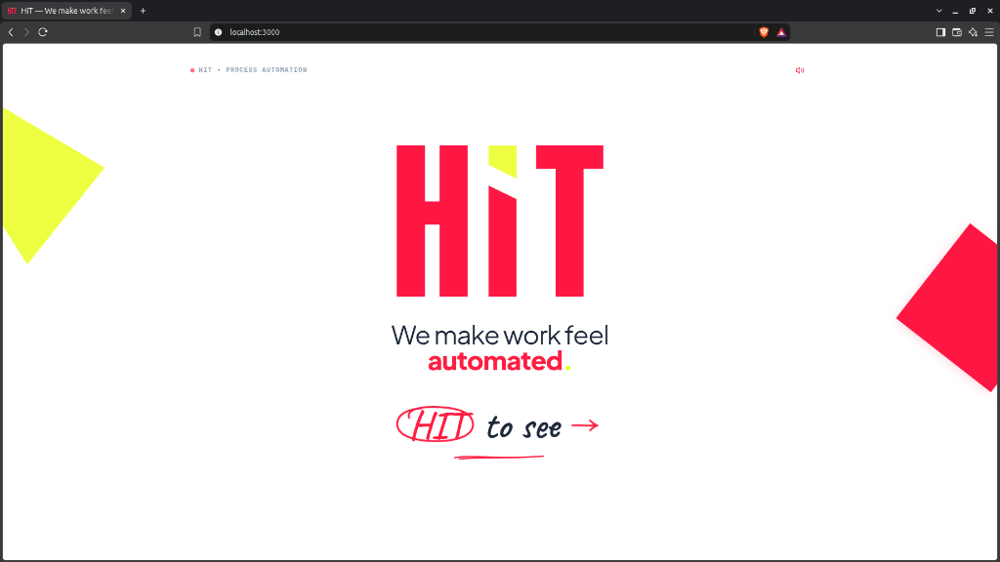
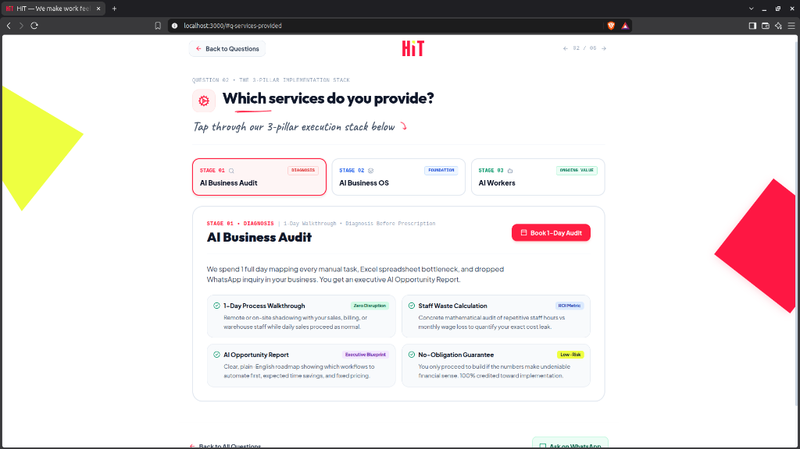
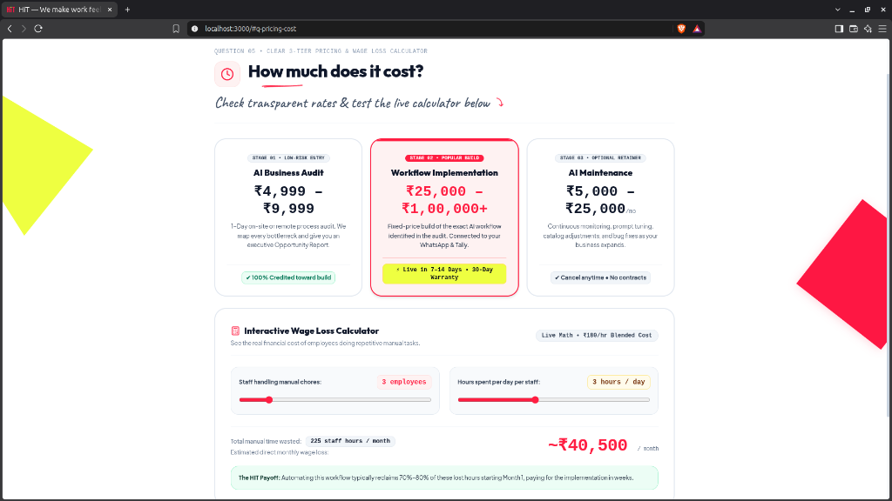
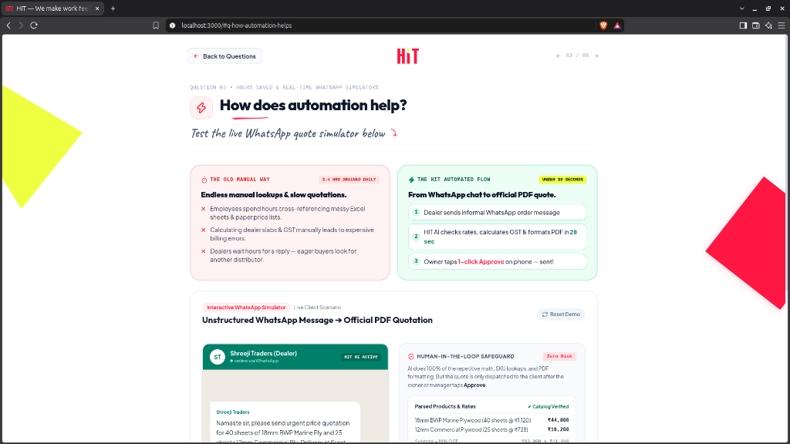
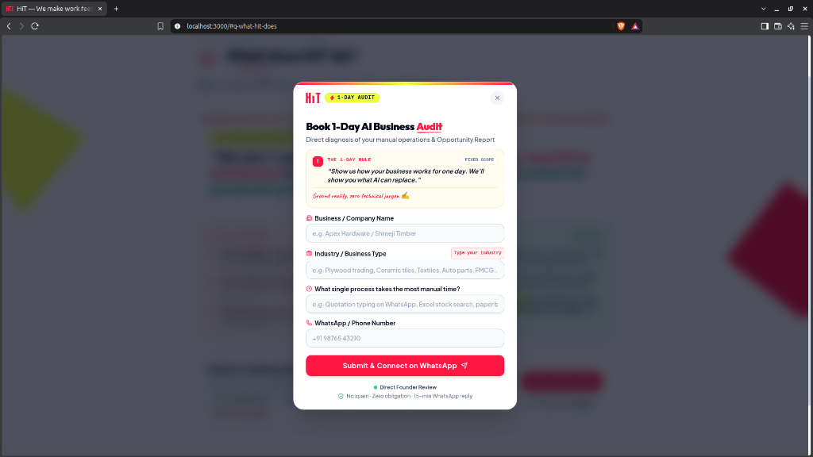
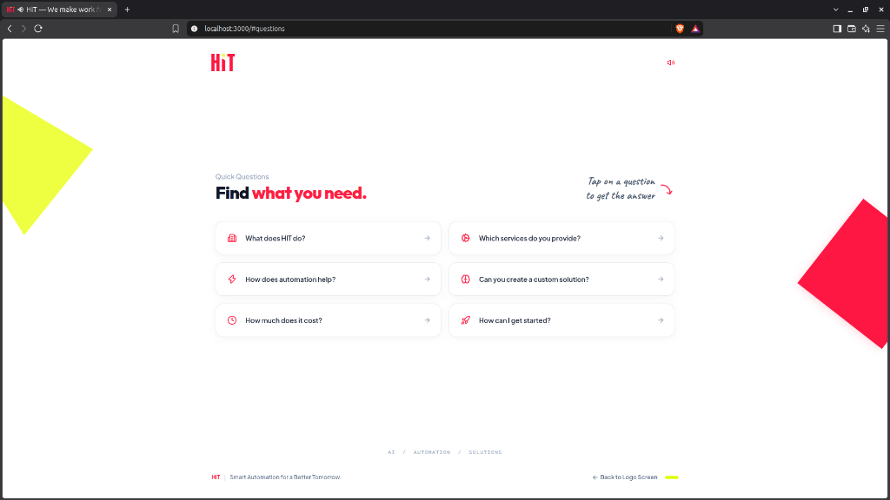
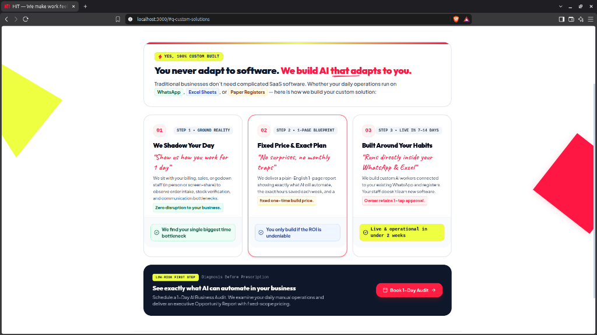

# ⚡ HIT AI Systems

[](LICENSE)
[](https://react.dev/)
[](https://www.typescriptlang.org/)
[](https://vitejs.dev/)
[](https://tailwindcss.com/)

> **Interactive, immersive web portal for AI services and Process Automation, featuring single-page full-screen state navigation, real-time Web Audio API sound effects, an interactive service audit modal, and dynamic simulation tools.**

---

## 📸 Screenshots

| 🏠 Home & Hero Showcase | 🛠 AI Services Portfolio |
| :---: | :---: |
|  |  |

| 🧮 Interactive Pricing Calculator | 🤖 Process Automation Simulator |
| :---: | :---: |
|  |  |

<details>
<summary><b>🔍 View Additional Screenshots</b></summary>

| 📋 Interactive Audit Modal | ❓ Questions Hub | 🎯 Custom Solutions |
| :---: | :---: | :---: |
|  |  |  |

</details>

---

## ✨ Key Features

- **Full-Screen State Navigation**: Smooth single-page application workflow with seamless stage transitions and synchronized browser history handling.
- **Web Audio API Sound Engine**: Custom synthesized acoustic feedback and dynamic audio cues on interactive clicks and screen transitions.
- **Interactive Process Automation Simulator**: Visual simulation showing real-time automation pipelines, cycle time reduction, and cost optimization.
- **Dynamic Pricing Calculator**: Live slider-based calculation tool for project scoping, turnaround estimation, and ROI projections.
- **Interactive Audit System**: Step-by-step diagnostic modal that analyzes business bottlenecks and recommends customized automation architectures.
- **High-Impact Visuals & Celebrations**: Canvas-confetti triggers, laser-accent badges, and hand-crafted cyberpunk/brutalist design aesthetic.

---

## 🛠 Tech Stack

- **Framework**: [React 18](https://react.dev/) + [Vite 6](https://vitejs.dev/)
- **Language**: [TypeScript](https://www.typescriptlang.org/)
- **Styling**: [Tailwind CSS](https://tailwindcss.com/)
- **Icons**: [Lucide React](https://lucide.dev/)
- **Audio**: Native HTML5 Web Audio API
- **VFX**: Canvas Confetti

---

## 🚀 Getting Started

### Prerequisites

- **Node.js**: v18+ (Node 20+ recommended)
- **npm** or **yarn** / **pnpm**

### Installation

1. **Clone the repository**:
   ```bash
   git clone https://github.com/hetansh21-pro/HIT.git
   cd HIT
   ```

2. **Install dependencies**:
   ```bash
   npm install
   ```

3. **Start local development server**:
   ```bash
   npm run dev
   ```
   Open [http://localhost:5173](http://localhost:5173) in your browser.

4. **Build for production**:
   ```bash
   npm run build
   ```

---

## 📖 About the Project

For detailed architectural details and design specifications, check out [**ABOUT.md**](ABOUT.md).

---

## 👤 Author

**Hetansh Patel**
- GitHub: [@hetansh21-pro](https://github.com/hetansh21-pro)
- Role: Process Automation & AI Systems
